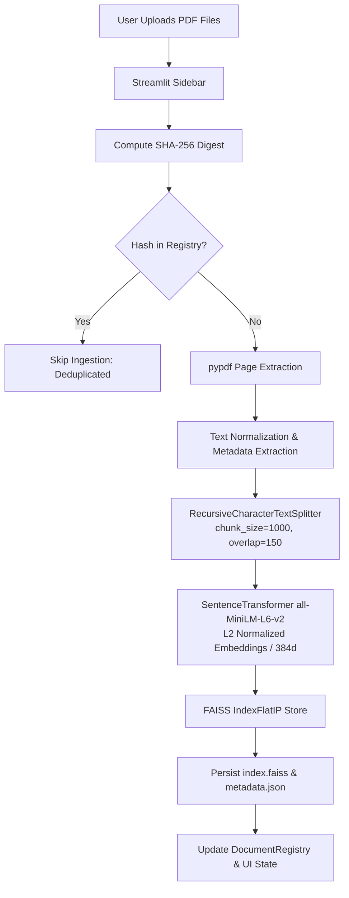
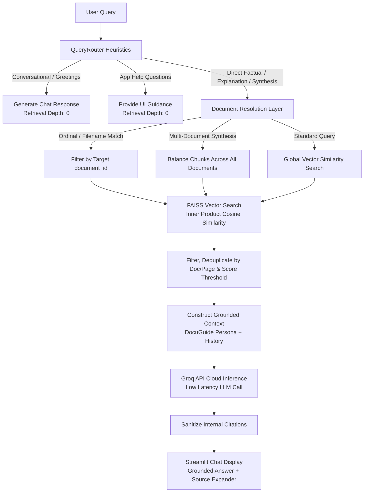
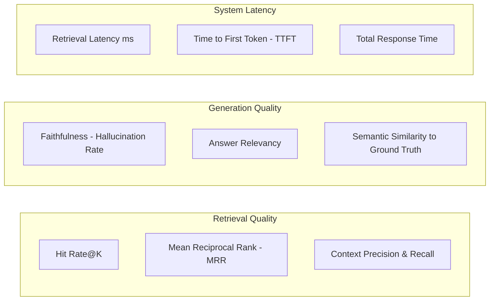

# RAG PDF Chatbot

[](https://www.python.org/)
[](https://streamlit.io/)
[](https://github.com/facebookresearch/faiss)
[](https://huggingface.co/sentence-transformers/all-MiniLM-L6-v2)
[](https://groq.com/)
[](LICENSE)
[](tests/)

A modular, production-engineered **Retrieval-Augmented Generation (RAG)** application designed to enable natural-language question answering across single and multiple PDF documents. Built with Python, Streamlit, local Hugging Face sentence transformers, persistent FAISS vector search, and ultra-low-latency LLM inference powered by the Groq Cloud API.

* **Live Application:** [https://rag-pdf-chatbot-nish.streamlit.app/](https://rag-pdf-chatbot-nish.streamlit.app/)
* **GitHub Repository:** [https://github.com/nishanths24/RAG-PDF-Chatbot](https://github.com/nishanths24/RAG-PDF-Chatbot)

---

## Table of Contents

- [1. Project Overview](#1-project-overview)
  - [The Problem](#the-problem)
  - [The Solution](#the-solution)
- [2. Key Features](#2-key-features)
- [3. Application Screenshots](#3-application-screenshots)
- [4. Architecture & System Design](#4-architecture--system-design)
  - [Data Ingestion Pipeline](#data-ingestion-pipeline)
  - [Query Routing & Retrieval Flow](#query-routing--retrieval-flow)
  - [Component Responsibilities](#component-responsibilities)
- [5. Technology Stack](#5-technology-stack)
- [6. Repository Structure](#6-repository-structure)
- [7. Installation and Local Setup](#7-installation-and-local-setup)
  - [Prerequisites](#prerequisites)
  - [Step-by-Step Installation (Windows PowerShell)](#step-by-step-installation-windows-powershell)
  - [Running the Application](#running-the-application)
- [8. Environment Variables and API Configuration](#8-environment-variables-and-api-configuration)
  - [Obtaining a Groq API Key](#obtaining-a-groq-api-key)
  - [Local Configuration (`.env`)](#local-configuration-env)
  - [Streamlit Community Cloud Deployment Secrets](#streamlit-community-cloud-deployment-secrets)
- [9. How to Use the Application](#9-how-to-use-the-application)
- [10. RAG Pipeline — Technical Deep Dive](#10-rag-pipeline--technical-deep-dive)
  - [1. PDF Extraction and Text Normalization](#1-pdf-extraction-and-text-normalization)
  - [2. Deterministic Chunking and Metadata Lineage](#2-deterministic-chunking-and-metadata-lineage)
  - [3. Local Embeddings & Vector Space Geometry](#3-local-embeddings--vector-space-geometry)
  - [4. FAISS Indexing & Persistent State Management](#4-faiss-indexing--persistent-state-management)
  - [5. Rule-Based Query Routing Layer](#5-rule-based-query-routing-layer)
  - [6. Multi-Perspective & Balanced Synthesis Retrieval](#6-multi-perspective--balanced-synthesis-retrieval)
  - [7. Grounded Context Construction & Groq Inference](#7-grounded-context-construction--groq-inference)
- [11. RAG Evaluation Methodology](#11-rag-evaluation-methodology)
- [12. Testing and Quality Assurance](#12-testing-and-quality-assurance)
  - [Running the Test Suite](#running-the-test-suite)
  - [Test Coverage Summary](#test-coverage-summary)
- [13. Deployment](#13-deployment)
- [14. Security, Privacy, and Limitations](#14-security-privacy-and-limitations)
- [15. Troubleshooting](#15-troubleshooting)
- [16. Engineering Roadmap](#16-engineering-roadmap)
- [17. Practical Engineering Takeaways](#17-practical-engineering-takeaways)
- [18. License and Acknowledgements](#18-license-and-acknowledgements)
- [19. Author and Contact](#19-author-and-contact)

---

## 1. Project Overview

### The Problem

Large Language Models (LLMs) operate with static knowledge frozen at pre-training time. When enterprise users, researchers, or students attempt to query private, proprietary, or recently published PDF documents, LLMs face critical challenges:
1. **Context Window Limitations & Cost:** Passing entire 50-to-200-page documents into an LLM context window causes context stuffing, degrades reasoning accuracy ("lost-in-the-middle" effect), and incurs substantial token costs.
2. **Hallucination:** Without strict grounding in verifiable source text, LLMs generate plausible yet incorrect statements.
3. **Absence of Provenance:** Generic chatbot outputs fail to cite exact source files and page numbers, making manual verification tedious.
4. **Multi-Document Disambiguation:** Users often upload multiple related files (e.g., quarterly reports, comparative analyses) and require the system to distinguish between questions targeted at a single document versus cross-document synthesis.

### The Solution

**RAG PDF Chatbot** addresses these challenges through a modular, decoupled Retrieval-Augmented Generation pipeline:
* **Local, Free Embeddings:** Document chunks are embedded locally using `sentence-transformers/all-MiniLM-L6-v2` running on CPU, eliminating per-token embedding API costs.
* **Efficient Vector Storage:** Embeddings are indexed in a local, persistent **FAISS** vector store using normalized inner-product similarity (cosine similarity).
* **Heuristic Query Routing:** A rule-based router categorizes user queries without adding LLM latency, skipping vector retrieval for conversational chitchat and app assistance, while scaling retrieval depth up to 6+ chunks for document synthesis.
* **Targeted Document Resolution & Synthesis:** Supports ordinal document selection (*"in the first document"*), exact filename targeting (*"in report.pdf"*), and balanced cross-document synthesis across multiple uploaded PDFs.
* **Grounded Answer Generation via Groq:** Synthesizes context-grounded responses using ultra-fast LPUs on Groq (`openai/gpt-oss-20b` or `llama-3.1-8b-instant`), instructed by a strict system persona (`DocuGuide`) to prevent out-of-context hallucinations.
* **Transparent Attribution:** Exposes exact file names, 1-based page numbers, and cosine similarity metrics in an interactive expander for auditability.

---

## 2. Key Features

- [x] **Multi-PDF Document Ingestion:** Upload multiple PDF files simultaneously via Streamlit file uploader with automated SHA-256 deduplication to prevent duplicate chunk indexing.
- [x] **Page-Level Extraction & Normalization:** Page-by-page text extraction via `pypdf` with whitespace normalization, tab stripping, and empty-page filtering.
- [x] **Deterministic Chunking & Metadata Lineage:** Recursive character splitting (1000 characters, 150-character overlap) preserving file name, 1-based page number, document ID, and deterministic chunk ID (`{doc_id}-p{page}-c{index}`).
- [x] **Local Semantic Embeddings:** 384-dimensional dense vectors generated locally on CPU using Hugging Face's `all-MiniLM-L6-v2` with L2 normalization.
- [x] **Persistent FAISS Vector Index:** Disk-persisted `IndexFlatIP` index with JSON metadata mapping, supporting load, save, document removal (with vector index reconstruction), and clearing.
- [x] **Persistent Document Catalog:** Dedicated `DocumentRegistry` tracking indexed document metadata (`document_id`, `file_name`, `file_hash`, `page_count`, `chunk_count`, timestamp).
- [x] **LLM-Free Query Routing:** Rule-based `QueryRouter` classifying queries into `CONVERSATIONAL`, `APP_HELP`, `DIRECT`, `EXPLANATION`, and `SYNTHESIS` to adapt retrieval depth dynamically (0 to 6+ chunks).
- [x] **Targeted Document Disambiguation:** Automatically resolves ordinal references (*"what is the second document about?"*) and filename queries (*"in Business.pdf"*) to target specific vector subsets.
- [x] **Balanced Cross-Document Synthesis:** Evenly distributes retrieved chunks across all indexed documents when broad synthesis queries are detected.
- [x] **Multi-Turn Chat History:** Maintains up to 3 conversation turns (6 messages) formatted into prompt context for conversational continuity.
- [x] **Defensive Citation Cleaning:** Post-processing regex sanitization (`\s*\[Source \d+\]`) ensuring clean natural-language answers while delegating citation display to the UI.
- [x] **Granular Document Management:** Live Streamlit sidebar allowing per-document removal or complete index purge with synchronized session reset.
- [x] **Comprehensive Automated Test Suite:** 104 verified passing unit and regression tests covering loaders, text splitters, vector stores, retrievers, routers, and QA chains.

---

## 3. Application Screenshots

<!-- 
  APPLICATION SCREENSHOT PLACEHOLDER
  To add application screenshots:
  1. Capture screenshots of:
     - The multi-document upload and indexed document sidebar
     - A targeted question answering response with 'View sources' expanded
     - Cross-document synthesis query output
  2. Save the image to 'assets/rag_chat_preview.png'
  3. Uncomment and adjust the Markdown below:
  
-->

> [!NOTE]
> Pre-packaged assets in the repository currently include UI avatar icons (`assets/assistant.png` and `assets/user.png`). To inspect the live application directly, visit the [Streamlit Cloud Deployment](https://rag-pdf-chatbot-nish.streamlit.app/).

---

## 4. Architecture & System Design

The application follows a clean layered architecture separating document ingestion, vector storage, retrieval routing, LLM generation, and UI presentation.

### Data Ingestion Pipeline



### Query Routing & Retrieval Flow



### Component Responsibilities

| Layer / Module | Primary File | Core Responsibilities |
| :--- | :--- | :--- |
| **Presentation** | `app.py`, `src/ui/` | Renders Streamlit controls, manages session state, handles file uploads, renders chat history, and displays source attribution cards. |
| **Application Services** | `src/services/` | Coordinates business workflows (`DocumentService`, `ChatService`, `DocumentRegistry`) bridging ingestion, retrieval, and chat state. |
| **Ingestion & ETL** | `src/ingestion/` | Validates file paths, parses PDF pages with `pypdf`, cleans whitespace artifacts, and segments text into overlapping chunks with chunk IDs. |
| **Embeddings** | `src/embeddings/` | Wraps Hugging Face `SentenceTransformer` to produce normalized 384-dimensional embeddings on CPU. |
| **Vector Indexing** | `src/vectorstore/` | Encapsulates `faiss.IndexFlatIP`, serializes index and metadata, and performs dynamic vector pruning upon document removal. |
| **Orchestration & Routing** | `src/orchestration/` | Regex-based `QueryRouter` identifying query intent and setting adaptive retrieval depths (0 to 6). |
| **Retrieval Engine** | `src/retrieval/` | Executes single-query and multi-query broad searches, document ID filtering, score thresholding, and multi-document chunk balancing. |
| **RAG & Inference** | `src/rag/` | Manages `DocuGuide` system prompt templates, formats multi-turn dialogue history, dispatches requests to Groq Cloud API, and cleans responses. |
| **Configuration** | `src/config/` | Loads YAML settings and `.env` files with strict schema validation. |

---

## 5. Technology Stack

| Category | Component / Library | Version (from `requirements.txt`) | Purpose in Project |
| :--- | :--- | :--- | :--- |
| **Runtime** | Python | `3.12` / `3.11` | Primary programming language |
| **Web UI** | Streamlit | `1.64.0` | Reactive web interface, session state management, and file uploader |
| **PDF Extraction** | PyPDF | `6.19.0` | Robust PDF parsing, page text extraction, and error handling |
| **Text Chunking** | LangChain Text Splitters | `1.1.2` | `RecursiveCharacterTextSplitter` with configurable chunk size and overlap |
| **Core Abstractions** | LangChain Core & Community | `1.6.4` / `0.4.2` | Standard `Document` representations and metadata schemas |
| **Embedding Model** | Sentence Transformers | `5.1.0` | `sentence-transformers/all-MiniLM-L6-v2` (384-dimensional embeddings) |
| **Vector Database** | FAISS CPU | `1.15.1` | In-memory `IndexFlatIP` with persistent disk serialization |
| **Deep Learning** | PyTorch & Transformers | `torch==2.8.0`, `transformers==4.57.1` | Local neural network execution backend for sentence transformers |
| **Numerics** | NumPy | `2.5.3` | Matrix manipulation, vector normalization, and FAISS array formatting |
| **LLM Provider** | Groq Cloud API | REST API / `openai==3.17.0` | High-speed LLM inference via Groq's OpenAI-compatible endpoint |
| **Config & Environment** | PyYAML, python-dotenv | `PyYAML==6.0.3`, `python-dotenv==1.2.3` | Hierarchical YAML settings (`settings.yaml`) and `.env` loading |
| **Data Validation** | Pydantic | `2.13.5` | Settings validation and data models |
| **Testing** | unittest | Standard Library | Automated unit and integration test suite (104 tests) |
| **Containerization** | Dev Containers | `.devcontainer/devcontainer.json` | VS Code / GitHub Codespaces environment configuration |

---

## 6. Repository Structure

```text
RAG-PDF-Chatbot/
├── .devcontainer/
│   └── devcontainer.json        # Containerized development configuration (Python 3.11/Streamlit)
├── .env.example                 # Example template for environment secrets (GROQ_API_KEY)
├── .gitignore                   # Excludes .env, virtual environments, data/uploads, data/vectorstore
├── .streamlit/
│   └── config.toml              # Streamlit server flags and light theme settings
├── LICENSE                      # MIT Open Source License
├── README.md                    # Project documentation and architectural specification
├── app.py                       # Streamlit application entry point and service orchestrator
├── config/
│   └── settings.yaml            # Default application parameters (chunking, retrieval top_k, model)
├── requirements.txt             # Pinned production Python dependencies
├── assets/
│   ├── assistant.png            # DocuGuide assistant chat avatar icon
│   └── user.png                 # User chat avatar icon
├── scripts/
│   ├── build_index.py           # CLI placeholder script for headless index building
│   └── clear_index.py           # CLI placeholder script for headless index clearing
├── src/
│   ├── __init__.py
│   ├── config/
│   │   ├── __init__.py
│   │   ├── settings.py          # Dataclass settings parser, path resolver, and validator
│   │   └── settings.yaml        # Packaged internal configuration copy
│   ├── embeddings/
│   │   ├── __init__.py
│   │   └── embedding_service.py # SentenceTransformer CPU wrapper with L2 vector normalization
│   ├── ingestion/
│   │   ├── __init__.py
│   │   ├── document_processor.py# Ingestion workflow: file resolution, hashing, and page loading
│   │   ├── exceptions.py        # Domain-specific hierarchy (EmptyPdfError, MalformedPdfError, etc.)
│   │   ├── pdf_loader.py        # PyPDF page-by-page reader and error mapping
│   │   └── text_splitter.py     # Recursive character text splitting and chunk ID generation
│   ├── orchestration/
│   │   ├── __init__.py
│   │   └── query_router.py      # Heuristic regex query classifier and dynamic retrieval depth
│   ├── rag/
│   │   ├── __init__.py
│   │   ├── groq_service.py      # Groq API HTTP client, error handling, and availability checks
│   │   ├── prompts.py           # DocuGuide persona, grounding rules, and prompt formatter
│   │   └── qa_chain.py          # QA pipeline: routing, retrieval, target resolution, and prompt dispatch
│   ├── retrieval/
│   │   ├── __init__.py
│   │   └── retriever.py         # Standard, broad multi-perspective, filtered, and balanced retrieval
│   ├── services/
│   │   ├── __init__.py
│   │   ├── chat_service.py      # High-level chat interface for Streamlit
│   │   ├── document_registry.py # Persistent JSON document catalog (page counts, hashes, chunks)
│   │   └── document_service.py  # Coordinates ingestion, chunking, embedding, indexing, and removal
│   ├── ui/
│   │   ├── __init__.py
│   │   ├── chat.py              # Streamlit chat message loop, input bar, and sources expander
│   │   ├── components.py        # Reusable UI widgets and source caption formatters
│   │   └── sidebar.py           # Sidebar layout: file uploader, slider, and AI stack credits
│   └── utils/
│       ├── __init__.py
│       ├── helpers.py           # SHA-256 chunked file hasher, text cleaner, and path helpers
│       └── logger.py            # Standardized application logging formatter
└── tests/
    ├── __init__.py
    ├── test_chat_service.py         # Tests for chat service delegation and error wrapping
    ├── test_document_processor.py   # Tests for end-to-end PDF processing and hash generation
    ├── test_document_resolution.py  # Tests for ordinal matching, filename queries, and synthesis
    ├── test_document_service.py     # Tests for multi-document indexing, removal, and deduplication
    ├── test_helpers.py              # Tests for normalization, file hashing, and extension checks
    ├── test_multi_document.py       # Integration tests for multi-doc registry and FAISS pruning
    ├── test_pdf_loader.py           # Tests for corrupted, empty, password-protected, and valid PDFs
    ├── test_query_router.py         # Tests for conversational, help, direct, and synthesis patterns
    ├── test_rag.py                  # Tests for prompt construction, Groq HTTP client, and fallbacks
    ├── test_retrieval.py            # Tests for FAISS retrieval, threshold filtering, and top_k bounds
    ├── test_runtime_regressions.py  # Regression tests for real-world queries and citation stripping
    ├── test_text_splitter.py        # Tests for chunk size bounds, overlap invariants, and metadata
    └── test_vectorstore.py          # Tests for FAISS IndexFlatIP dimension safety and serialization
```

---

## 7. Installation and Local Setup

### Prerequisites

* **Operating System:** Windows 10/11, macOS, or Linux.
* **Python:** Python 3.11 or 3.12 (Python 3.12 recommended).
* **Git:** Installed and available on your PATH.
* **Hardware:** ~4 GB available RAM recommended for local sentence-transformer models.
* **API Access:** A free [Groq Cloud API Key](https://console.groq.com/keys).

### Step-by-Step Installation (Windows PowerShell)

#### 1. Clone the repository
```powershell
git clone https://github.com/nishanths24/RAG-PDF-Chatbot.git
cd RAG-PDF-Chatbot
```

#### 2. Create a virtual environment
```powershell
py -3.12 -m venv .venv
```
*(On Linux/macOS, use: `python3 -m venv .venv`)*

#### 3. Activate the virtual environment
```powershell
.\.venv\Scripts\Activate.ps1
```
*(If script execution is disabled in PowerShell, run `Set-ExecutionPolicy -Scope Process -ExecutionPolicy RemoteSigned` first. On Linux/macOS, run `source .venv/bin/activate`)*

#### 4. Upgrade pip and install dependencies
```powershell
python -m pip install --upgrade pip
pip install -r requirements.txt
```

#### 5. Configure environment variables
Copy the `.env.example` file to `.env`:
```powershell
Copy-Item .env.example .env
```

Open `.env` in your text editor and add your Groq API key:
```env
GROQ_API_KEY=gsk_your_actual_groq_api_key_here
```

### Running the Application

Launch the Streamlit web application:
```powershell
streamlit run app.py
```
Or execute directly using the virtual environment interpreter:
```powershell
.\.venv\Scripts\python.exe -m streamlit run app.py --server.port 8501
```

Once started, open your browser and navigate to:
```text
http://localhost:8501
```

---

## 8. Environment Variables and API Configuration

### Obtaining a Groq API Key

1. Navigate to the [Groq Console](https://console.groq.com/).
2. Sign in or create an account.
3. In the left navigation, select **API Keys**.
4. Click **Create API Key**, give it a name (e.g., `rag-pdf-chatbot`), and copy the generated key.

### Local Configuration (`.env`)

The project uses `python-dotenv` to inject environment variables into the runtime.

```env
# .env
GROQ_API_KEY=gsk_example_key_do_not_commit_real_keys
```

> [!WARNING]
> **Security Notice:** Never commit `.env` or hardcode API keys into source code. Verify that `.env` remains listed in `.gitignore` before making any git commits.

### Streamlit Community Cloud Deployment Secrets

When deploying to [Streamlit Community Cloud](https://share.streamlit.io/):
1. Navigate to your app dashboard and select **App Settings**.
2. Select the **Secrets** tab.
3. Add your Groq API key in TOML format:
   ```toml
   GROQ_API_KEY = "gsk_your_actual_groq_api_key_here"
   ```
4. Save the secret. Streamlit Community Cloud injects this value into `os.environ["GROQ_API_KEY"]` automatically.

---

## 9. How to Use the Application

```text
Step 1: Upload Documents       Step 2: Inspect Knowledge Base     Step 3: Query & Inspect Sources
┌───────────────────────────┐  ┌───────────────────────────────┐  ┌───────────────────────────────────┐
│ • Select one or more PDFs │  │ • View indexed document list  │  │ • Ask factual, targeted, or broad │
│ • Automatic SHA-256 dedupe│─►│ • Adjust 'Number of sources'  │─►│   synthesis questions             │
│ • Real-time indexing      │  │ • Remove single doc or clear  │  │ • Expand 'View sources' for page  │
│                           │  │   all documents               │  │   and similarity attribution      │
└───────────────────────────┘  └───────────────────────────────┘  └───────────────────────────────────┘
```

1. **Upload Documents:** Use the file uploader in the left sidebar to upload one or more PDF files. The system computes a SHA-256 hash for each document. If a document has already been indexed, it avoids redundant re-indexing.
2. **Review Document Library:** The sidebar displays all indexed documents along with page counts and chunk counts. You can remove individual documents using the **Remove** button or reset the vector store completely with **Clear All Documents**.
3. **Configure Retrieval Depth:** Use the **Number of sources** slider (2 to 10 chunks, default 6) to control the retrieval context window sent to the LLM.
4. **Ask Questions:** Type questions into the chat input bar at the bottom.
   * **Conversational queries:** *"Hello"*, *"How can you help me?"*, *"Who are you?"* (Handled conversationally without retriever calls).
   * **App guidance queries:** *"Where do I upload PDFs?"*, *"How do I remove a document?"* (Handled via built-in application instructions).
   * **Targeted document queries:** *"What are the key conclusions in the first document?"* or *"What methodology is used in Business.pdf?"* (Routed directly to that document's vector subset).
   * **Cross-document synthesis queries:** *"Summarize all uploaded documents"*, *"What are the common themes across these PDFs?"* (Retrieval is balanced across all indexed documents).
5. **Inspect Citations:** Click **View sources** under any assistant response to view the exact document name, 1-based page number, and similarity score for each retrieved chunk.

---

## 10. RAG Pipeline — Technical Deep Dive

### 1. PDF Extraction and Text Normalization

The ingestion pipeline ([src/ingestion/pdf_loader.py](file:///c:/Users/nisha/OneDrive/Desktop/RAG%20PDF%20Chatbot/src/ingestion/pdf_loader.py)) parses documents page by page using `pypdf.PdfReader`:
* **Exception Mapping:** Protects against corrupt or unreadable PDFs by catching `EmptyFileError`, `PdfReadError`, and `PdfStreamError`, raising structured application exceptions (`EmptyPdfError`, `MalformedPdfError`, `NoExtractableTextError`).
* **Text Normalization:** Extracted text is passed to `normalize_extracted_text()` ([src/utils/helpers.py](file:///c:/Users/nisha/OneDrive/Desktop/RAG%20PDF%20Chatbot/src/utils/helpers.py)), which standardizes CRLF/CR line endings to `\n`, converts form-feed (`\x0c`) breaks, replaces non-breaking spaces (`\u00a0`) and tabs with standard spaces, collapses consecutive spaces, strips trailing whitespace per line, and squashes 3+ consecutive newlines into double newlines.
* **Preserving Page Numbers:** Empty or scanned pages without extractable text are skipped, while 1-based page numbers are preserved on valid pages.

### 2. Deterministic Chunking and Metadata Lineage

Chunks are generated using LangChain's `RecursiveCharacterTextSplitter` ([src/ingestion/text_splitter.py](file:///c:/Users/nisha/OneDrive/Desktop/RAG%20PDF%20Chatbot/src/ingestion/text_splitter.py)):
* **Configuration:** Default `chunk_size = 1000` characters with `chunk_overlap = 150` characters. Overlap ensures that semantic thoughts spanning chunk boundaries are not lost.
* **Deterministic Lineage:** Every chunk inherits the source metadata and receives a unique, reproducible chunk identifier:
  $$\text{chunk\_id} = \{\text{document\_id}\}\text{-p}\{\text{page}\}\text{-c}\{\text{chunk\_index}\}$$
  This deterministic scheme allows tracing any retrieved context snippet back to its original file and page.

### 3. Local Embeddings & Vector Space Geometry

Dense vector representations are computed locally via `EmbeddingService` ([src/embeddings/embedding_service.py](file:///c:/Users/nisha/OneDrive/Desktop/RAG%20PDF%20Chatbot/src/embeddings/embedding_service.py)):
* **Model:** `sentence-transformers/all-MiniLM-L6-v2` (22.7M parameters, 384-dimensional embedding space).
* **Hardware Execution:** Runs on CPU (`device="cpu"`), ensuring portability across cloud containers and standard laptops without requiring a dedicated GPU.
* **L2 Vector Normalization:** Every embedding is normalized using `normalize_embeddings=True`:
  $$\mathbf{u} = \frac{\mathbf{v}}{\|\mathbf{v}\|_2}$$
  In a normalized vector space, the inner product between two vectors equals their cosine similarity:
  $$\langle \mathbf{u}_1, \mathbf{u}_2 \rangle = \frac{\mathbf{v}_1 \cdot \mathbf{v}_2}{\|\mathbf{v}_1\|_2 \|\mathbf{v}_2\|_2} = \cos(\theta)$$
  This property allows FAISS to use inner product search (`IndexFlatIP`) while producing exact cosine similarity rankings.

### 4. FAISS Indexing & Persistent State Management

Vector storage is managed by `FAISSVectorStore` ([src/vectorstore/faiss_store.py](file:///c:/Users/nisha/OneDrive/Desktop/RAG%20PDF%20Chatbot/src/vectorstore/faiss_store.py)):
* **Index Structure:** Uses `faiss.IndexFlatIP(384)`, an exact (brute-force) inner product index that provides 100% recall without quantization loss.
* **Disk Serialization:** Persists the binary index to `data/vectorstore/index.faiss` and document text/metadata to `data/vectorstore/metadata.json`.
* **Dynamic Pruning via Reconstruction:** Because standard flat FAISS indexes do not natively support removing arbitrary vector IDs without re-indexing, the class implements `remove_document(document_id)` by extracting surviving vectors via `_index.reconstruct(i)`, rebuilding a clean index in memory, and re-persisting to disk without requiring raw PDF re-parsing.

### 5. Rule-Based Query Routing Layer

Rather than introducing an LLM call to classify queries (which adds 300–800ms of latency and consumes API tokens), `QueryRouter` ([src/orchestration/query_router.py](file:///c:/Users/nisha/OneDrive/Desktop/RAG%20PDF%20Chatbot/src/orchestration/query_router.py)) uses regex heuristics:

| Query Mode | Trigger Pattern Examples | Retrieval Depth | Action Taken |
| :--- | :--- | :---: | :--- |
| `CONVERSATIONAL` | `"hi"`, `"good morning"`, `"thanks"`, `"who are you"` | 0 | Skips retriever; LLM answers conversationally. |
| `APP_HELP` | `"how do i upload"`, `"how to delete pdf"`, `"where is upload"` | 0 | Skips retriever; LLM provides built-in app instructions. |
| `DIRECT` | General factual queries (*"what is the budget?"*) | 3 | Standard semantic search. |
| `EXPLANATION` | Queries starting with `"explain"`, `"why"`, `"how does"` | 4–5 | Enhanced retrieval depth for detailed explanations. |
| `SYNTHESIS` | `"summarize"`, `"overview"`, `"all pdf"`, `"across documents"` | 6+ | Multi-perspective broad retrieval with cross-doc balancing. |

### 6. Multi-Perspective & Balanced Synthesis Retrieval

The retriever ([src/retrieval/retriever.py](file:///c:/Users/nisha/OneDrive/Desktop/RAG%20PDF%20Chatbot/src/retrieval/retriever.py)) implements advanced retrieval modes:
* **Multi-Query Perspective Expansion:** When broad summary queries are detected, the system generates embeddings for multiple orthogonal queries (e.g., *"What is the main topic and purpose...?"*, *"What are the key objectives and methods...?"*, *"What are the important findings and conclusions...?"*), searches FAISS with an expanded candidate pool ($k = 50$), deduplicates matches by chunk ID, and selects the highest-scoring candidate per passage.
* **Target Document Filtering:** When the user refers to a specific document by ordinal (*"in the first document"*) or filename (*"in Business.pdf"*), `QAChain` matches the reference against `DocumentRegistry` and restricts retrieval to chunks where `metadata["document_id"] == target_id`.
* **Balanced Cross-Document Synthesis:** For synthesis queries spanning all uploaded documents, retrieval balances chunks across documents:
  $$\text{max\_per\_doc} = \max\left(1, \left\lfloor \frac{\text{top\_k}}{\text{num\_unique\_docs}} \right\rfloor\right)$$
  This prevents a single lengthy PDF from dominating the context window.

### 7. Grounded Context Construction & Groq Inference

* **Persona & Grounding:** `DocuGuide` ([src/rag/prompts.py](file:///c:/Users/nisha/OneDrive/Desktop/RAG%20PDF%20Chatbot/src/rag/prompts.py)) acts as a grounded knowledge assistant. The prompt explicitly instructs the model to treat the retrieved PDF context as its primary source of truth, say *"I couldn't find enough information in the uploaded document to answer that confidently"* when context is insufficient, and refrain from outputting internal citation brackets like `[Source 1]`.
* **Conversation History:** Up to 3 previous turns (6 messages) are passed into the prompt, enabling follow-up questions without losing conversational context.
* **Groq Cloud API Execution:** Calls `https://api.groq.com/openai/v1/chat/completions` ([src/rag/groq_service.py](file:///c:/Users/nisha/OneDrive/Desktop/RAG%20PDF%20Chatbot/src/rag/groq_service.py)) with `temperature: 0.0` for deterministic, grounded outputs.
* **Sanitization:** Answers pass through `re.sub(r'\s*\[Source \d+\]', '', answer)` to eliminate any leaked source markers, ensuring a clean reading experience while letting the UI render structured citations independently.

---

## 11. RAG Evaluation Methodology

### Verification Status & Scope

> [!IMPORTANT]
> **Status: Formal Quantitative Benchmarks Not Yet Verified**
> While the repository includes an automated test suite verifying software correctness and retrieval logic (see [Testing](#12-testing-and-quality-assurance)), **formal quantitative RAG evaluation metrics (such as Hit Rate@K, MRR, Ragas Faithfulness, or latency distributions) have not been formally run against benchmark test sets in this codebase.** 
> To maintain strict technical integrity, no fabricated benchmark scores, precision percentages, or latency numbers are reported.

### Theoretical Evaluation Framework for Future Iterations

A production-grade RAG evaluation framework distinguishes between three distinct quality dimensions:



#### 1. Retrieval Metrics
* **Hit Rate@K:** Proportion of test queries where at least one ground-truth ground passage appears in the top-$K$ retrieved chunks:
  $$\text{Hit Rate@K} = \frac{1}{|Q|} \sum_{q \in Q} \mathbb{I}(\text{relevant chunk} \in \text{Top-}K(q))$$
* **Mean Reciprocal Rank (MRR):** Measures where the first relevant chunk appears in the ranked results list:
  $$\text{MRR} = \frac{1}{|Q|} \sum_{i=1}^{|Q|} \frac{1}{\text{rank}_i}$$
* **Context Precision:** Ratio of retrieved context chunks that are genuinely relevant to the query.
* **Context Recall:** Extent to which all information required to answer the query was successfully retrieved.

#### 2. Generation & Answer Quality Metrics
* **Faithfulness (Hallucination Detection):** Ratio of factual claims in the generated response that can be mathematically verified from the retrieved context:
  $$\text{Faithfulness} = \frac{|\text{Verifiable Claims in Answer}|}{|\text{Total Claims in Answer}|}$$
* **Answer Relevancy:** Measures whether the generated answer directly addresses the user's prompt without introducing extraneous or repetitive statements.

#### 3. Proposed Evaluation Workflow
Future iterations can implement automated evaluation via [Ragas](https://github.com/explodinggradients/ragas) or [TruLens](https://www.trulens.org/) using a golden test dataset of diverse documents (academic papers, financial disclosures, technical documentation) paired with verified question-answer-context triples.

---

## 12. Testing and Quality Assurance

The codebase includes an automated test suite developed with Python's standard `unittest` framework. All external dependencies (such as Groq API HTTP endpoints and long file I/O operations) are hermetically mocked to guarantee deterministic, reproducible test execution.

### Running the Test Suite

Execute the complete test suite from the repository root:

```powershell
python -m unittest discover -s tests -v
```
*(Or on Windows with virtualenv: `.\.venv\Scripts\python.exe -m unittest discover -s tests -v`)*

### Test Coverage Summary

```text
----------------------------------------------------------------------
Ran 104 tests in 0.362s

OK
```

The **104 tests** span 13 dedicated test modules:

| Test Module | Test Focus & Verification Scope |
| :--- | :--- |
| [`test_pdf_loader.py`](file:///c:/Users/nisha/OneDrive/Desktop/RAG%20PDF%20Chatbot/tests/test_pdf_loader.py) | Verifies extraction on valid PDFs; asserts expected exceptions on non-existent files, empty files, password-encrypted PDFs, non-PDF formats, and PDFs lacking extractable text. |
| [`test_text_splitter.py`](file:///c:/Users/nisha/OneDrive/Desktop/RAG%20PDF%20Chatbot/tests/test_text_splitter.py) | Validates chunk size limits, overlap invariants (`overlap < chunk_size`), deterministic chunk ID generation, and metadata preservation. |
| [`test_vectorstore.py`](file:///c:/Users/nisha/OneDrive/Desktop/RAG%20PDF%20Chatbot/tests/test_vectorstore.py) | Tests FAISS index creation, vector count tracking, dimension validation (rejecting vectors $\neq 384$), empty store behavior, index serialization, and reloading. |
| [`test_retrieval.py`](file:///c:/Users/nisha/OneDrive/Desktop/RAG%20PDF%20Chatbot/tests/test_retrieval.py) | Verifies `top_k` validation, similarity threshold filtering, empty query handling, and embedding delegation. |
| [`test_query_router.py`](file:///c:/Users/nisha/OneDrive/Desktop/RAG%20PDF%20Chatbot/tests/test_query_router.py) | Tests regex heuristics for conversational greetings, app help inquiries, direct factual questions, explanations, and synthesis modes; tests adaptive retrieval depth assignment. |
| [`test_rag.py`](file:///c:/Users/nisha/OneDrive/Desktop/RAG%20PDF%20Chatbot/tests/test_rag.py) | Verifies prompt template assembly, Groq service HTTP headers and payload formatting, mock 200 responses, network failure handling, and fallback messages when retrieval yields no chunks. |
| [`test_document_resolution.py`](file:///c:/Users/nisha/OneDrive/Desktop/RAG%20PDF%20Chatbot/tests/test_document_resolution.py) | Verifies ordinal resolution (*"first document"*, *"second pdf"*), filename resolution (*"Business.pdf"*), citation cleaning (`[Source N]` stripping), and display deduplication for chunks on the same page. |
| [`test_multi_document.py`](file:///c:/Users/nisha/OneDrive/Desktop/RAG%20PDF%20Chatbot/tests/test_multi_document.py) | Tests `DocumentRegistry` operations, SHA-256 deduplication preventing re-indexing, cross-document retrieval, and FAISS vector reconstruction during document removal. |
| [`test_document_service.py`](file:///c:/Users/nisha/OneDrive/Desktop/RAG%20PDF%20Chatbot/tests/test_document_service.py) | Tests coordination across ingestion, chunking, embedding, vector addition, and registry updates. |
| [`test_chat_service.py`](file:///c:/Users/nisha/OneDrive/Desktop/RAG%20PDF%20Chatbot/tests/test_chat_service.py) | Verifies `ChatService` interface contracts, question trimming, and history propagation. |
| [`test_runtime_regressions.py`](file:///c:/Users/nisha/OneDrive/Desktop/RAG%20PDF%20Chatbot/tests/test_runtime_regressions.py) | Verifies fixes for known runtime edge cases including synthesized responses across multiple documents and conversational boundary conditions. |
| [`test_helpers.py`](file:///c:/Users/nisha/OneDrive/Desktop/RAG%20PDF%20Chatbot/tests/test_helpers.py) | Verifies chunked SHA-256 calculation, whitespace normalization, and file extension checks. |
| [`test_document_processor.py`](file:///c:/Users/nisha/OneDrive/Desktop/RAG%20PDF%20Chatbot/tests/test_document_processor.py) | Tests high-level path resolution and document ingestion. |

---

## 13. Deployment

### Live Deployment Details

* **Hosting Platform:** Streamlit Community Cloud
* **Live Demo URL:** [https://rag-pdf-chatbot-nish.streamlit.app/](https://rag-pdf-chatbot-nish.streamlit.app/)
* **Repository Source:** Connected directly to branch `main` at `https://github.com/nishanths24/RAG-PDF-Chatbot`
* **Entry Point File:** `app.py`

### Deployment Architecture & Resource Management

Deploying local embedding models on Streamlit Community Cloud's free-tier containers (~1 GB RAM limit) requires careful memory and dependency management:
1. **Lightweight Embedding Weights:** `all-MiniLM-L6-v2` requires only ~90MB of model weights, fitting comfortably within container memory limits on CPU.
2. **Offloading Generation Compute:** By delegating LLM generation to the Groq Cloud API, the container avoids running large language models in memory, ensuring fast response times and preventing container crashes.
3. **Headless Execution:** `.streamlit/config.toml` configures `fileWatcherType = "none"`, preventing memory leaks from Streamlit file watcher polling on Linux containers.
4. **Dev Containers:** A complete container specification is provided in `.devcontainer/devcontainer.json` for development inside VS Code or GitHub Codespaces.

---

## 14. Security, Privacy, and Limitations

### Security & Privacy Considerations

* **API Key Protection:** API keys are never stored in source code. Local execution loads keys from `.env` via `python-dotenv`, which is excluded by `.gitignore`. Cloud deployments rely on encrypted secrets management.
* **Data Transmission to External LLM:** While text extraction, chunking, and embedding generation occur strictly locally, **retrieved document text chunks matching the user's query are transmitted over HTTPS to the Groq Cloud API for answer generation.** Sensitive or confidential documents subject to strict internal compliance should not be uploaded without enterprise Groq data agreements.
* **Local Ephemeral File Storage:** Uploaded files and vector indices are written to `data/uploads/` and `data/vectorstore/`. These directories are ignored in Git, ensuring user documents are never committed to version control.

### Technical Limitations

* **No Optical Character Recognition (OCR):** The current ingestion pipeline relies exclusively on `pypdf`. Scanned documents, photocopies, or image-only PDFs lacking embedded text layers will raise a `NoExtractableTextError`.
* **In-Memory Exact Search Scaling:** `FAISSVectorStore` uses `IndexFlatIP`. While optimal for low-to-medium volume document libraries (hundreds to thousands of pages), very large corporate datasets (millions of chunks) would require approximate nearest neighbor indices (such as FAISS `IndexHNSW` or `IndexIVFFlat`).
* **Heuristic Query Routing:** `QueryRouter` relies on regular expressions and keyword matching. Complex or ambiguously phrased queries may default to direct search rather than multi-document synthesis.
* **Context Truncation:** Responses depend on the quality of retrieved passages within the configured `top_k` context window (default 4 to 6 chunks).

---

## 15. Troubleshooting

| Symptom / Error Message | Root Cause | Solution |
| :--- | :--- | :--- |
| `GroqServiceError: GROQ_API_KEY is not configured` | Missing `.env` file or variable name typo. | Verify that a `.env` file exists in the repository root and contains `GROQ_API_KEY=gsk_...`. For Streamlit Cloud, verify the key under **Settings > Secrets**. |
| `NoExtractableTextError: No extractable text was found in the PDF` | The uploaded PDF is a scanned image or lacks a digital text layer. | The current pipeline requires text-selectable PDFs. Process the document through an external OCR tool or convert it using Adobe Acrobat / OCRmyPDF prior to upload. |
| `VectorStoreDimensionError: Expected embedding dimension 384, received X` | The FAISS index was created with a different embedding model or dimension. | Clear the index by clicking **Clear All Documents** in the sidebar or deleting the `data/vectorstore/` folder, then re-index the document. |
| `EmptyPdfError: The PDF file is empty` | The uploaded file has a file size of 0 bytes or contains 0 pages. | Verify that the PDF file is valid and opens correctly in a standard PDF viewer before uploading. |
| `Streamlit duplicate element key error` | Re-uploading or modifying documents created identical widget keys. | Click **Clear All Documents** in the sidebar to reset session state, or refresh your browser tab. |
| ModuleNotFoundError when running tests | PYTHONPATH does not include the project root. | Run tests using `python -m unittest discover -s tests -v` from the project root directory rather than running test scripts from inside the `tests/` folder. |

---

## 16. Engineering Roadmap

The following architectural enhancements represent planned future milestones:

- [ ] **Hybrid Search (Dense + Sparse Retrieval):** Integrate BM25 keyword search alongside FAISS dense vectors, combined via Reciprocal Rank Fusion (RRF) for improved handling of exact acronyms and part numbers.
- [ ] **Cross-Encoder Reranking:** Add a two-stage retrieval pipeline using a cross-encoder model (e.g., `bge-reranker-base`) to re-score the top 20 candidate passages before passing the top 4 to the LLM.
- [ ] **OCR Ingestion Support:** Integrate `pytesseract` or `easyocr` as an automated fallback for scanned, image-only PDF documents.
- [ ] **Streaming LLM Token Generation:** Implement token streaming via Server-Sent Events (SSE) from the Groq API into `st.write_stream` for lower perceived latency.
- [ ] **Automated Evaluation Harness:** Build an offline evaluation pipeline using [Ragas](https://github.com/explodinggradients/ragas) to score Faithfulness, Answer Relevance, and Context Recall across regression test suites.
- [ ] **Telemetry & Tracing:** Integrate OpenTelemetry or LangSmith for real-time observability into retrieval latencies, token consumption, and retrieval failure modes.

---

## 17. Practical Engineering Takeaways

Building this production-style RAG system demonstrates several practical AI engineering competencies:

1. **Vector Space Geometry:** Leveraging normalized vectors so that inner product search mathematically equals cosine similarity, maximizing CPU retrieval throughput.
2. **Defensive Error Hierarchies:** Implementing domain-specific exceptions (`IngestionError`, `PdfNotFoundError`, `VectorStoreDimensionError`) rather than catching generic runtime exceptions.
3. **Adaptive Retrieval Depth:** Using rule-based routing to conserve context tokens and eliminate latency on conversational interactions while allocating expanded context budgets for document synthesis.
4. **State Management & Vector Pruning:** Managing multi-document registries and reconstructing FAISS indices dynamically during document deletions without requiring complete database wipes.
5. **Prompt Engineering & Grounding:** Structuring prompt contracts to enforce document grounding, suppress hallucinations, and cleanly separate answer text from citation metadata.

---

## 18. License and Acknowledgements

### License

This project is licensed under the **MIT License**. See the [LICENSE](LICENSE) file for details.

### Acknowledgements

* [Meta AI FAISS](https://github.com/facebookresearch/faiss) for high-performance vector similarity search.
* [Hugging Face Sentence Transformers](https://sbert.net/) for the `all-MiniLM-L6-v2` embedding model.
* [Groq Cloud](https://groq.com/) for high-throughput, low-latency LLM inference.
* [Streamlit](https://streamlit.io/) for the reactive web application framework.
* [PyPDF](https://github.com/py-pdf/pypdf) for page-level PDF parsing.
* [LangChain](https://github.com/langchain-ai/langchain) for robust text splitting abstractions.

---

## 19. Author and Contact

**Nishanth S**  
Computer Science & Engineering (AI & ML)  

* **GitHub:** [@nishanths24](https://github.com/nishanths24)  
* **Project Repository:** [https://github.com/nishanths24/RAG-PDF-Chatbot](https://github.com/nishanths24/RAG-PDF-Chatbot)  
* **Live Application:** [https://rag-pdf-chatbot-nish.streamlit.app/](https://rag-pdf-chatbot-nish.streamlit.app/)